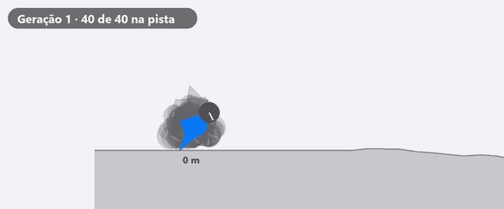
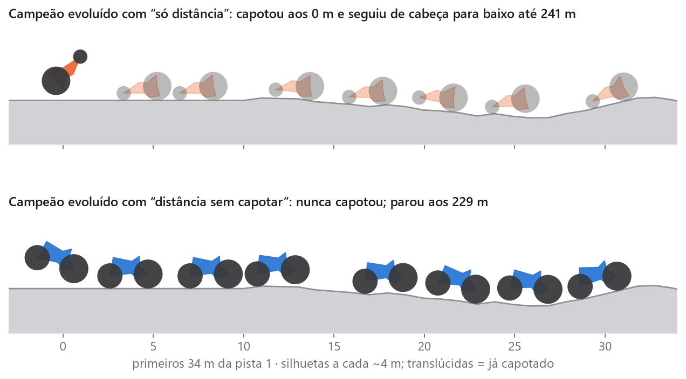
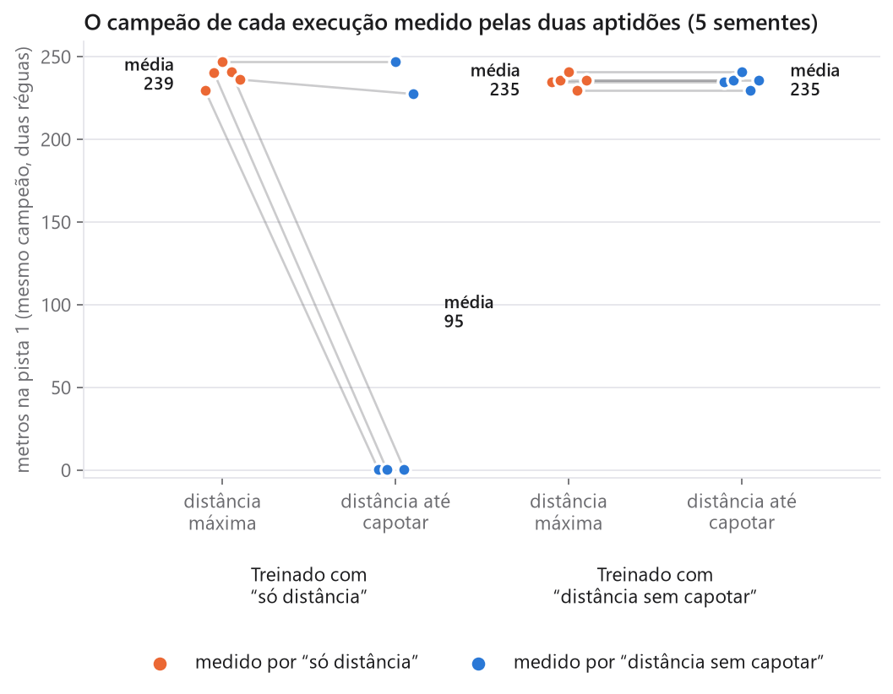
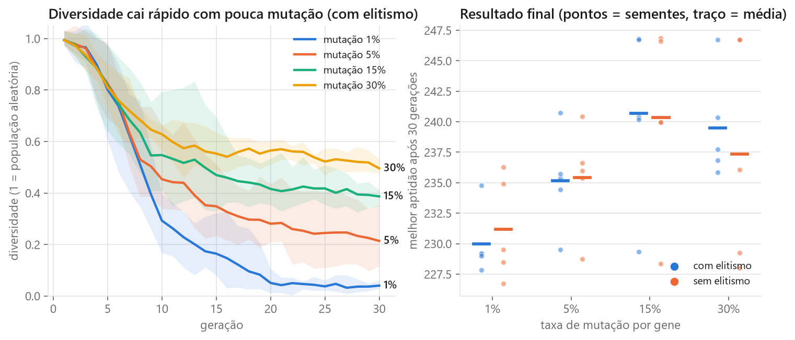
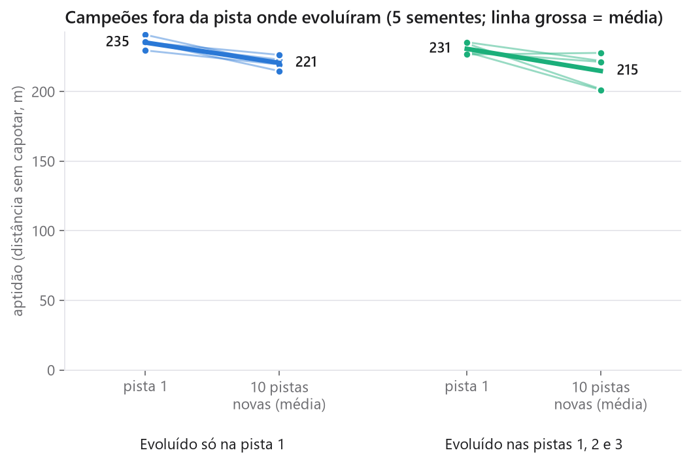
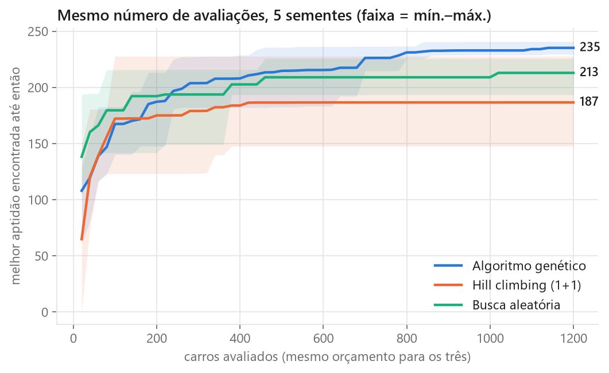

# Algoritmos genéticos: carros que ninguém projetou

**Demo ao vivo: [yucavalcante.com/algoritmos-geneticos](https://yucavalcante.com/algoritmos-geneticos/)** · [](https://github.com/YUCAVALCANTE/algoritmos-geneticos/actions/workflows/ci.yml)



Uma população de 40 carros 2D tenta atravessar uma pista acidentada. Ninguém programou como um bom carro deve ser: cada carro é só um cromossomo de 14 números (formato da carroceria, posição e tamanho das rodas, densidade das peças), e o algoritmo genético recebe apenas **o que conta como bom**. Seleção, cruzamento e mutação fazem o resto.

Este projeto acompanha o artigo [**"Algoritmos genéticos: quando uma máquina encontra soluções que ninguém programou"**](https://medium.com/@yucavalcante/algoritmos-gen%C3%A9ticos-quando-uma-m%C3%A1quina-encontra-solu%C3%A7%C3%B5es-que-ningu%C3%A9m-programou-1a6fbd77c3da), da série *IA sem mágica* no Medium. O artigo usa os carros numa pista como exemplo central e levanta quatro pontos; aqui cada um vira um experimento reproduzível:

| Ponto do artigo | Pergunta testada | Resposta curta |
|---|---|---|
| A função de aptidão define o que é "bom" | O que acontece se a aptidão medir só a distância horizontal? | Ela vira o objetivo. Com "só distância", 3 de 5 campeões capotam na largada e andam de cabeça para baixo apoiados numa roda gigante: 239 m na métrica ingênua, 95 m na honesta. |
| Pouca diversidade leva à convergência prematura | Como taxa de mutação e elitismo afetam a diversidade e o resultado final? | Com 1% de mutação a população vira quase clones (diversidade 0,04) e para em 230 m; com 15%, mantém 0,39 e chega a 241 m. O elitismo pouco mudou. |
| Uma solução boa num ambiente pode falhar em outro | O campeão de uma pista funciona em pistas nunca vistas? E evoluindo em várias ao mesmo tempo? | Perde 6% em 10 pistas novas. Evoluir em 3 pistas ao mesmo tempo não ajudou (perda de 7%): resultado negativo, discutido abaixo. |
| AG não é mágica | Ele supera busca aleatória e hill climbing com o mesmo número de avaliações? | Sim, com folga moderada: 235 m contra 213 m (aleatória) e 187 m (hill climbing), média de 5 sementes. |

O exemplo de 30 segundos do artigo, letras aleatórias evoluindo até a palavra **REVOADA**, está numa aba da demo, com os parâmetros do texto (população de 200, mutação de 5% por letra, torneio de 5, cruzamento de um ponto, elitismo de 1, semente 42). O artigo não diz em quantas gerações a palavra aparece: com a semente 42 são **8 gerações (1.600 palavras avaliadas)**, e nas sementes 1 a 10, de 5 a 9, contra 26⁷ ≈ 8 bilhões de combinações possíveis. (O nome é uma referência ao [projeto Revoada](https://github.com/YUCAVALCANTE/agente-revoada), o agente de visão computacional da mesma série.)

---

## 1. Como o problema foi representado

**Cromossomo** (14 genes reais em [0, 1], decodificados em `web/src/carro.js`):

| Genes | Significado | Faixa física |
|---|---|---|
| 0–7 | distância de cada um dos 8 vértices da carroceria ao centro (ângulos fixos a cada 45°) | 0,25–1,6 m |
| 8, 10 | vértice onde cada uma das duas rodas está presa | vértice 0–7 |
| 9, 11 | raio de cada roda | 0,18–0,85 m |
| 12, 13 | densidade da carroceria e das rodas | 0,6–5 kg/m² |

**Física**: [planck.js](https://github.com/piqnt/planck.js) (porta em JavaScript do Box2D), passo fixo de 1/30 s. As duas rodas têm motor com a mesma velocidade e torque máximo para todos os carros: o AG só controla a forma e a massa. A corrida acaba quando o carro cruza a chegada, fica 4 s sem avançar 30 cm, passa de 60 s ou, na aptidão robusta, capota (carroceria girada mais de ~110°).

**Pista**: gerada por semente (`web/src/pista.js`). Depois de 10 m planos, 320 segmentos de 1 m cuja inclinação segue um passeio aleatório suavizado; a inclinação máxima cresce de 9° no começo a 86° no fim, então a pista fica mais difícil à medida que o carro avança (~277 m até a chegada na pista 1).

**Duas aptidões**:
- *só distância* (`ingenua`): a maior posição horizontal que a carroceria alcançou, de qualquer jeito;
- *distância sem capotar* (`robusta`): a posição alcançada até o momento em que o carro capota; quem cruza a chegada sem capotar ganha 1 m por segundo poupado.

**Algoritmo genético** (`web/src/ga.js`): população de 40, seleção por torneio de 3, cruzamento uniforme (90%), mutação gaussiana por gene (σ = 0,2, refletida nas bordas) e elitismo opcional de 2 indivíduos. **Diversidade** = desvio-padrão médio dos genes, dividido pelo de uma população uniforme (1 = aleatória, 0 = clones).

### Determinismo: o mesmo número no navegador e no Node

Cada carro roda no próprio mundo físico, então o resultado não depende dos outros carros nem da ordem de avaliação: a demo, que avança a geração inteira em lockstep na tela, e o Node, que avalia um carro por vez, chegam ao mesmo número. Um detalhe só apareceu na prática: `Math.sin`, `Math.cos` e `Math.atan2` não são exigidos pela especificação a dar o mesmo último bit em todo motor, e o Node e o Chromium divergiam (31,5017 m contra 31,5015 m no mesmo carro). Numa simulação caótica isso basta para o melhor carro da geração 1 ir a 113,8 m num e 81,3 m no outro. A correção foi escrever trigonometria e logaritmo só com operações que o IEEE 754 exige exatas (`web/src/dmath.js`) e trocá-las dentro do planck.js (`scripts/vendorizar-planck.mjs`). Um teste fixa o valor de referência (81,28788015352924 m) e o CI confere em Linux e Windows, em duas versões do Node.

---

## 2. Protocolo

- Pista de treino: nº 1. Pistas de teste (generalização): nº 101 a 110, nunca usadas no treino.
- Cada configuração do AG: 40 carros × 30 gerações = **1.200 avaliações**, **5 sementes** (1 a 5).
- Configuração de referência: aptidão robusta, mutação 5%, torneio 3, elitismo ligado.
- Linhas de base com o mesmo orçamento de 1.200 avaliações e as mesmas 5 sementes:
  - **busca aleatória**: 1.200 carros sorteados de forma independente;
  - **hill climbing (1+1)**: muta o carro atual (cada gene com probabilidade 20%, σ = 0,15, ao menos um gene) e fica com o vizinho se ele não for pior.
- O AG com elitismo reavalia os 2 elites a cada geração; essas reavaliações contam no orçamento (desvantagem para o AG).
- Números: média das 5 sementes, com os valores individuais nos gráficos. Com 5 sementes, diferenças pequenas não são conclusivas; o texto diz quando é o caso.

---

## 3. Resultados

### 3.1 Aptidão mal formulada: o "monociclo de cabeça para baixo"



Com a aptidão "só distância", o AG encontrou um carro que ninguém desenharia: uma carroceria pequena presa a uma roda enorme, que **capota no primeiro segundo** e atravessa a pista de cabeça para baixo, rolando sobre a roda grande. Pela métrica que o algoritmo recebeu, ele é tão bom quanto os outros; pelo objetivo que eu tinha em mente (um carro que anda), ele não fez nada.



| Campeões evoluídos com... (5 sementes, pista 1) | "só distância" | "distância sem capotar" |
|---|---|---|
| ...aptidão "só distância" | 239 m | **95 m** (3 de 5 com 0 m: capotaram na largada) |
| ...aptidão "distância sem capotar" | 235 m | 235 m (nenhum capotou) |

Os outros 2 campeões da aptidão ingênua também capotaram, só que tarde (aos 227 m e 247 m). Nenhum dos 5 evoluídos com a aptidão robusta capotou. É o exemplo do artigo, o carro "arremessado" que maximiza a métrica errada, aparecendo sozinho a partir de uma regra de pontuação de uma linha. Ele lembra também o carro A × carro B do texto: 200 m com 3 capotamentos não é melhor que 180 m sem nenhum, a não ser que a aptidão diga isso.

### 3.2 Convergência prematura: mutação e elitismo



| Mutação por gene | Diversidade na geração 30 (com elitismo) | Melhor após 30 gerações, com elitismo | sem elitismo |
|---|---|---|---|
| 1% | 0,04 | 230 m | 231 m |
| 5% (referência) | 0,21 | 235 m | 235 m |
| 15% | 0,39 | **241 m** | 240 m |
| 30% | 0,50 | 240 m | 237 m |

- Com 1%, em 20 gerações a população vira praticamente cópias do mesmo carro e o progresso para: nenhuma das 5 sementes passou de 236 m.
- Subir para 15% mantém variedade e dá o melhor resultado médio. Com 30%, a diversidade é maior ainda, mas o resultado não melhora: parte das boas combinações é destruída a cada geração. É o equilíbrio entre exploração e explotação de que o artigo fala, e o ponto ótimo depende do problema.
- O elitismo quase não mudou o resultado final; ele reduz um pouco a diversidade (0,21 contra 0,28 com 5% de mutação) e garante que o melhor da geração nunca piora, o que se vê no gráfico da demo. Com 5 sementes, diferenças de 1 a 3 m entre com e sem elitismo não são conclusivas.
- Os resultados se acumulam em patamares (~229 m, ~235–241 m, ~247 m): são trechos da pista que exigem uma mudança de forma maior para serem vencidos, os ótimos locais do problema.

### 3.3 Generalização: pistas nunca vistas



| Campeões evoluídos... | Pista 1 | Média nas pistas 101–110 | Pior pista nova |
|---|---|---|---|
| só na pista 1 | 235 m | 221 m (−6%) | 193 m |
| nas pistas 1, 2 e 3 (aptidão = média) | 231 m | 215 m (−7%) | 151 m |

- O campeão de uma pista perde pouco nas outras: as 10 pistas de teste saem do mesmo gerador, com a mesma dificuldade crescente, então o que o AG aprendeu (um carro baixo, de rodas grandes, que não vira) serve para todas.
- **Evoluir em várias pistas ao mesmo tempo não melhorou a generalização aqui.** A expectativa era a oposta. Duas explicações plausíveis, que não testei: com o mesmo número de gerações e a média de 3 pistas como aptidão, a seleção fica menos precisa (um carro ótimo numa pista e ruim noutra empata com um mediano em todas); e, como as pistas são parecidas, há pouca especialização a corrigir. Testar isso exigiria pistas de estilos diferentes e mais gerações.

### 3.4 Linhas de base com o mesmo orçamento



| Método (1.200 avaliações, 5 sementes) | Melhor aptidão média | Faixa entre sementes |
|---|---|---|
| **Algoritmo genético** | **235 m** | 229–241 m |
| Busca aleatória | 213 m | 193–226 m |
| Hill climbing (1+1) | 187 m | 148–228 m |

- O AG venceu nas 5 sementes, mas a busca aleatória é uma linha de base forte: com 14 genes e uma pista que começa fácil, sortear 1.200 carros já encontra um que faz 200 m. O AG só se descola depois de ~400 avaliações, quando a seleção começa a combinar as boas peças.
- O hill climbing foi o pior: ele melhora um único carro por pequenos passos e trava no primeiro ótimo local (numa semente, em 148 m). Com reinícios aleatórios ele seria outro algoritmo, mais próximo da busca aleatória.
- Nenhum método cruzou a chegada (277 m) com 1.200 avaliações.

---

## 4. Limitações

- **Um problema, um gerador de pistas.** As conclusões valem para esta física e esta pista; outro problema pode mudar a ordem das linhas de base e a melhor taxa de mutação.
- **5 sementes por configuração.** Suficiente para os efeitos grandes (aptidão errada, mutação de 1%, AG contra hill climbing); diferenças de poucos metros, como com e sem elitismo, ficam dentro do ruído. Não há teste estatístico formal.
- **Orçamento pequeno.** 30 gerações de 40 carros (1.200 avaliações) cabem em ~3 min por execução; com mais gerações as curvas continuariam subindo e a comparação entre métodos pode mudar.
- **Sem ajuste fino das linhas de base.** O hill climbing não tem reinícios e os parâmetros de todos os métodos foram escolhidos uma vez, sem busca de hiperparâmetros. O AG também não foi otimizado além das taxas testadas.
- **A "distância sem capotar" ainda é uma métrica.** Ela fecha a brecha do capotamento, mas o AG pode achar outras (por exemplo, carros que avançam aos trancos). Toda aptidão é uma aproximação do objetivo real, que é o ponto do artigo.
- **Determinismo depende do código, não do hardware.** Os resultados são idênticos no Node (Windows e Linux) e no Chromium; não testei Firefox e Safari, que usam outros motores JavaScript, mas a física só usa operações exatas do IEEE 754 depois da troca da trigonometria.

---

## 5. Como reproduzir

Requisitos: Node 22+ (sem dependências de npm) e, para os gráficos, Python 3.11+ com matplotlib, numpy e pillow.

```bash
npm test                                   # seleção, cruzamento, mutação, determinismo (~3 s)
node experimentos/rodar.js --rapido        # fumaça: 2 gerações, nada é salvo
node experimentos/rodar.js                 # 60 execuções em paralelo; retoma de onde parou
node experimentos/analisar.js              # examina campeões e pistas de teste → resultados/resumo.json
python experimentos/graficos.py            # figuras em web/figuras/
node experimentos/gif_dados.js && python experimentos/gif.py   # GIF do topo
```

Para ver a demo localmente: `python -m http.server -d web 8000` e abra `http://localhost:8000`. O endereço da página guarda a configuração (`?semente=1&pista=1&pop=40&mut=0.05&torneio=3&elite=1&aptidao=robusta`), e no console `__demo.geracoes(3)` roda três gerações sem animação e devolve a melhor aptidão de cada uma, para comparar com o Node.

### Estrutura

```
web/                 demo (GitHub Pages) e todo o código de simulação, compartilhado com o Node
  src/rng.js         gerador pseudoaleatório com semente (sfc32)
  src/dmath.js       sin, cos, atan2 e log determinísticos
  src/pista.js       pista gerada por semente
  src/carro.js       cromossomo → carro
  src/simulacao.js   corrida de um carro, aptidões
  src/ga.js          torneio, cruzamento, mutação, elitismo, diversidade
  src/revoada.js     o exemplo REVOADA
  vendor/planck.mjs  planck.js 1.5.1 com a trigonometria trocada
experimentos/        rodar.js (pool de threads), nucleo.js (AG e linhas de base), analisar.js, graficos.py, gif.py
testes/              node:test
```

Pista, carros, arte e nomes são originais e gerados por código. Código sob licença MIT; planck.js sob MIT (ver `web/vendor/planck-LICENSE.txt`).
